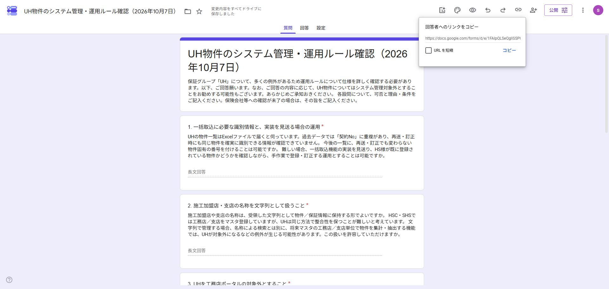

# UH運用ルール確認フォーム（6問）

- 回答後の決定：オーナーがUHポータル除外、工務店／支店方式と支店のコード保持、申込年月の1日、上棟日＋92日の起算日を部分採用。契約番号と加盟店コードはHSへ再確認済み・回答待ち。[採用記録](../../docs/requirements/source-materials.md#2026-10-07-uh回答に対するオーナーの仕様確定と再確認連絡)。以下は送付時の原文を保ち、旧90日の設問を現在の確定仕様と混同しない。
- 作成日：2026-10-07。根拠：本Codexタスクで、オーナーが元の1～6を提案内容で修正しGoogleフォームを作成するよう指示。追加の不足事項は後発とし、今回は含めない。
- 状態：作成・保存・公開済み。回答者用リンクで6問・必須表示・有効な送信ボタンを確認。HSへの連絡・回答のテスト送信は行っていない。
- 回答確認：2026-10-07、1件中1件・全6問を読了。画面の送信日時は2026/10/07 14:11（時間帯の明示なし）。[回答要旨・既存資料との相違](../../docs/requirements/source-materials.md#2026-10-07-uh運用ルール確認フォームの回答読取)を記録。仕様採用・元資料訂正・実データ削除・実装変更は行っていない。
- [回答者用フォーム](https://docs.google.com/forms/d/e/1FAIpQLSeQgIiSSP6YaPoYykHj0ZrvjfnVoDEJPWfmCCyRJXJ-c1q7Iw/viewform)
- [編集用フォーム](https://docs.google.com/forms/d/1p_YLtxSeoh7jsMJevaFe2jeJ67pYVr3DRd2wlb2tj4U/edit)
- [プレビュー](https://docs.google.com/forms/d/1p_YLtxSeoh7jsMJevaFe2jeJ67pYVr3DRd2wlb2tj4U/preview)
- 回答形式：全6問が段落・必須。メールアドレスを収集しない、1回制限なし、質問シャッフルなし、回答概要公開なし。
- 元の設問順から⑥を⑤の前へ移し、フォーム上は1～6に振り直した。期間のずれの許容を確認してから90日計算を質問する。
- [検討資料](../../docs/design/uh-integration-proposal-2026-10-06.md)。質問の採用はUH仕様・取込方式の採用ではない。アプリ・Dev・実データは変更していない。

## 冒頭

保証グループ「UH」について、多くの例外があるため運用ルールについて仕様を詳しく確認する必要があります。以下、ご回答願います。なお、ご回答の内容に応じて、UH物件についてはシステム管理対象外とすることをお勧めする可能性もございます。あらかじめご承知おきください。

各設問について、可否と理由・条件をご記入ください。保険会社等への確認が未了の場合は、その旨をご記入ください。

## 1. 一括取込に必要な識別情報と、実装を見送る場合の運用

UHの物件一覧はExcelファイルで届くと伺っています。過去データでは「契約No」に重複があり、再送・訂正時にも同じ物件を確実に識別できる情報が確認できていません。
今後の一覧に、再送・訂正でも変わらない物件固有の番号を付けることは可能ですか。
難しい場合、一括取込機能の実装を見送り、HS様が既に登録されている物件かどうかを確認しながら、手作業で登録・訂正する運用とすることは可能ですか。

## 2. 施工加盟店・支店の名称を文字列として扱うこと

施工加盟店や支店の名称は、受領した文字列として物件／保証情報に保持する形でよいですか。
HSC・SHSでは工務店／支店をマスタ登録していますが、UHは同じ方法で整合性を保つことが難しいと考えています。
文字列で管理する場合、名称による検索とは別に、将来マスタの工務店／支店単位で物件を集計・抽出する機能では、UHが対象外になるなどの例外が生じる可能性があります。この扱いを許容していただけますか。

## 3. UHを工務店ポータルの対象外とすること

今回のUH管理方式では、工務店ポータルの対象外とする仕様で支障ありませんか。
工務店ポータルは、マスタで管理する工務店／支店ごとに担当者の閲覧・操作範囲を決める機能です。UHでは施工加盟店・支店を同様にマスタ管理せず、受領した名称だけで担当者の所属や閲覧範囲を確定できないため、今回の方式ではポータルを提供しない方針です。将来の提供は別途検討となります。

## 4. 申込年月の1日を運用上の申込日とすること

申込年月までしか分からないUH物件は、その月の初日（1日）をシステム上の申込日として扱うことは可能ですか。
保証番号の年度判定等に申込日を利用するため、運用ルールに基づく補完が必要です。これは実際の申込日が1日だったという意味ではなく、年月しか分からない場合の運用上の日付です。

## 5. 算出日と実際の引渡日の差による期間のずれ

UHの保証書には、保証期間が「お施主様引渡日より10年間」と記載されています。
上棟年月日から算出した日付をシステム上の引渡日・保証開始日・保険開始日として扱う場合、実際の引渡日と算出日が異なると、システムで管理する保証・保険期間と、保証書の記載による施主様への保証期間にずれが生じる可能性があります。
この差を許容していただけますか。また、保証の発行主体および保険会社にも了承される扱いでしょうか。未確認の場合は、その旨をご記入ください。

## 6. 上棟年月日に90日を加算した日を引渡日とすること

前問の期間のずれを許容できることを前提に、上棟年月日に暦日90日を加算した日を、システム上の引渡日・保証開始日・保険開始日とすることは可能ですか。
上棟日は年月日まで必須とし、翌日を1日目として90日を数えます。休日や営業日は考慮しません。
「3か月後」でも月末の調整方法を決めれば計算できますが、一定の日数で明確に扱うため90日をお勧めします。暦の3か月後とは異なる日付になる場合があるため、保険会社にも「90日後」という条件で了承いただけるかをご確認ください。前問で許容できない場合は、その旨をご記入ください。

## 確認結果と承認境界

編集画面で全変更のドライブ保存を確認。回答者プレビューで6問の文面と必須表示を確認。初回の公開操作は自動承認レビューが明示承認不足として拒否した。2026-10-07の本Codexタスクでオーナーが「公開していいよ」と明示承認し、その後「リンクを知っている全員」を回答者とする設定で公開した。編集画面の公開済み表示と回答者用リンクを確認し、そのリンクで6問すべての必須表示・入力欄と有効な送信ボタンを確認した。回答は入力・送信していない。ログアウト状態での回答操作は未検証。フォーム公開による通知はなく、HSへのメール等も送信していない。

公開前の確認画像は `preview.png`。今回は本記録と公開確認画像だけを更新し、質問文面・アプリ・Dev・業務データ・仕様・進捗・権限のルールは変更しない。
